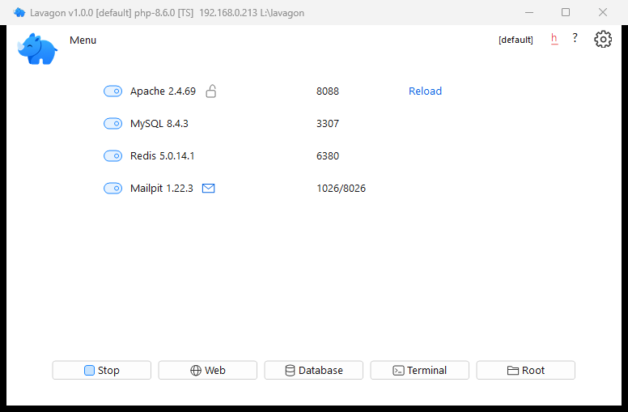
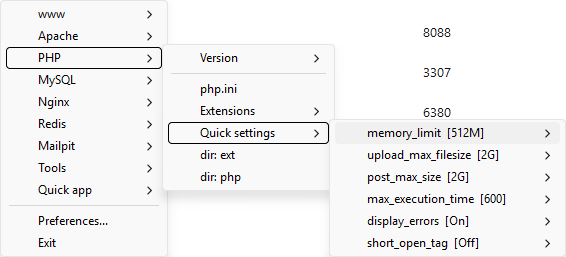

<div align="center">


# Lavagon

**A portable, open source local development environment for Windows.**
Apache / Nginx · PHP 5.6 – 8.6 · MySQL / MariaDB · PostgreSQL · Redis · Mailpit — in one tiny window.

[](https://github.com/funwkwk/lavagon/releases/latest)
[](LICENSE)




</div>

---

## Contents

- [Why Lavagon](#why-lavagon)
- [Features](#features)
- [Quick start](#quick-start)
- [Getting the components](#getting-the-components)
- [PHP compatibility](#php-compatibility)
- [Folder layout](#folder-layout)
- [Configuration](#configuration)
- [Building from source](#building-from-source)
- [Project structure](#project-structure)
- [Contributing](#contributing)
- [License](#license)
- [Bahasa Indonesia](#bahasa-indonesia)

## Why Lavagon

- **Portable** — one folder, no installer, no Windows services. Copy it to another PC and it keeps working.
- **Tiny** — a ~370 KB executable on .NET Framework 4.8, which ships with every Windows 10/11.
- **Never touches your binaries** — Apache, PHP, MySQL… stay pristine in `bin\`; everything Lavagon generates lives in `etc\`.
- **Every PHP version** — from 5.6 to 8.6 side by side, switch with two clicks.

## Features

| | |
| --- | --- |
| **One click** | *Start All / Stop* for every enabled service, plus a switch per service. Lavagon finds its services again after a restart. |
| **Web servers** | Apache 2.4 with mod_php (Thread Safe PHP), or Nginx with php-cgi (works with NTS builds too). |
| **Databases** | MySQL / MariaDB (data directory initialized automatically, graceful shutdown, create database, change / copy root password, backup all databases), PostgreSQL, MongoDB. |
| **Pretty URLs** | Every folder in `www` becomes `http://<folder>.test`. Laravel/Symfony `public/` folders are detected. Use `{name}.localhost` to never need the hosts file. |
| **HTTPS** | A *Lavagon Local CA* signs one certificate per site (Windows crypto API, no openssl.exe needed). Trust it once from *Menu > Apache > SSL*. |
| **PHP** | Per-version `php.ini`, extension toggles, quick settings (memory_limit, upload size…), `mail()` goes to Mailpit, `date.timezone` from your Windows location. |
| **Quick app** | Create Blank, WordPress, Laravel, Symfony, CodeIgniter, Slim, CakePHP projects. Recipes are plain text in `usr\sites.conf`. |
| **Tools** | Terminal with every tool on `PATH` (Cmder if present), HeidiSQL/Adminer button, Redis, Memcached, Mailpit web UI, Node.js and Python version switching, *Add Lavagon to Path*. |
| **Comfort** | Tray icon, run at Windows startup, run minimized, start all automatically, clear error messages (port in use, missing VC++ runtime, wrong architecture…). |

<details>
<summary>Menu</summary>



</details>

## Quick start

1. Get `Lavagon.exe`: download the portable zip from [Releases](https://github.com/funwkwk/lavagon/releases/latest) or [build it yourself](#building-from-source). Put it into an empty folder, e.g. `C:\lavagon`.
2. Extract at least **Apache**, **PHP (Thread Safe x64)** and **MySQL** into `bin\` — see [Getting the components](#getting-the-components).
3. Run `Lavagon.exe` and click **Start All**.
4. Create `C:\lavagon\www\myapp\index.php` and open **http://myapp.test** (Lavagon asks once for admin rights to update the hosts file).

> [!TIP]
> Run several independent environments with `Lavagon.exe --root D:\other-lavagon` or the `LAVAGON_ROOT` environment variable.

## Getting the components

Each tool lives in `bin\<tool>\<version>\`. Extract the official Windows zip into a new sub folder and it appears in the menu — keep as many versions as you like.

| Component | Folder example | Download |
| --- | --- | --- |
| Apache 2.4 | `bin\apache\httpd-2.4.xx-Win64-VS17` | [Apache Lounge](https://www.apachelounge.com/download/) |
| PHP (Thread Safe, x64) | `bin\php\php-8.4.xx-Win32-vs17-x64` | [windows.php.net](https://windows.php.net/download/) |
| MySQL (ZIP archive) | `bin\mysql\mysql-8.4.x-winx64` | [dev.mysql.com](https://dev.mysql.com/downloads/mysql/) |
| MariaDB (ZIP) | `bin\mysql\mariadb-11.x-winx64` | [mariadb.org](https://mariadb.org/download/) |
| Nginx | `bin\nginx\nginx-1.2x.x` | [nginx.org](https://nginx.org/en/download.html) |
| Redis | `bin\redis\redis-x64-5.0.14.1` | [tporadowski/redis](https://github.com/tporadowski/redis/releases) |
| Mailpit | `bin\mailpit\1.2x.x` | [axllent/mailpit](https://github.com/axllent/mailpit/releases) |
| PostgreSQL | `bin\postgresql\postgresql-17` | [EDB binaries](https://www.enterprisedb.com/download-postgresql-binaries) |
| Node.js / Python | `bin\nodejs\node-v22`, `bin\python\python-3.13` | [nodejs.org](https://nodejs.org/), [python.org](https://www.python.org/downloads/windows/) |
| Composer, HeidiSQL, Git, Cmder, Notepad++ | `bin\composer\composer.phar`, `bin\heidisql\`, … | optional |

PHP, Apache and MySQL need the [Microsoft Visual C++ Redistributable (x64)](https://aka.ms/vs/17/release/vc_redist.x64.exe); PHP 5.6 also needs the [2012 version](https://www.microsoft.com/download/details.aspx?id=30679). Lavagon tells you if one is missing.

## PHP compatibility

Tested with the official Windows builds (Thread Safe, x64) on Apache 2.4 (mod_php, HTTP and HTTPS), Nginx (php-cgi) and the CLI:

| PHP | Apache | Nginx | CLI | MySQL 8.4 login |
| --- | :-: | :-: | :-: | --- |
| 5.6, 7.0 | ✅ | ✅ | ✅ | ❌ impossible with MySQL 8.4+ — use MariaDB or MySQL 5.7 / 8.0 |
| 7.1 – 7.3 | ✅ | ✅ | ✅ | ✅ with *Menu > MySQL > Legacy authentication* |
| 7.4 – 8.6 | ✅ | ✅ | ✅ | ✅ |

How Lavagon makes every version work:

- **php.ini per version**, generated from `php.ini-development`: `extension=php_x.dll` for PHP < 7.2 and `extension=x` for newer versions, `gd2` vs `gd`, `zend_extension` with a full path on old builds. Default extensions that cannot load are switched off automatically.
- **No DLL hell**: Apache preloads PHP's own DLLs (`php8ts.dll`, OpenSSL 1.1 / 3 / 4, libssh2, ICU…) in dependency order, so same-named DLLs of another version (for example copied into Apache's `bin` by another stack) are never used.
- **Health checks** before starting: missing or old Visual C++ runtime, x86 vs x64, NTS build with Apache — with a message telling you exactly what to install.
- **MySQL 8 and old PHP**: *Legacy authentication* switches `root` to `mysql_native_password` and starts MySQL with it as the default plugin.

## Folder layout

```text
Lavagon\
├─ Lavagon.exe
├─ bin\      third-party binaries: bin\<tool>\<version>\   (never modified)
├─ etc\      generated configuration: apache2, nginx, php, mysql, ssl
├─ data\     database data: mysql-8.4, postgresql-17, redis, mailpit…
├─ www\      document root – every folder is a site
├─ usr\      lavagon.ini, sites.conf, usr\bin (your scripts, on PATH)
├─ logs\     service logs and lavagon.log
└─ tmp\      pid files, sessions, uploads
```

## Configuration

| What | Where |
| --- | --- |
| Lavagon settings | `usr\lavagon.ini` (or *Menu > Preferences*) |
| Apache main config — regenerated on every start | `etc\apache2\httpd.conf` |
| Your own Apache directives | `etc\apache2\custom.conf` |
| Virtual hosts | `etc\apache2\sites-enabled\` — files named `auto.*` are generated; rename one to drop `auto.` and Lavagon keeps your version |
| Nginx | `etc\nginx\nginx.conf`, `custom.conf`, `sites-enabled\` |
| PHP | `etc\php\<php folder>\php.ini` (the CLI uses it too, via `PHPRC`) |
| MySQL | `etc\mysql\<mysql folder>\my.ini` |
| Certificates | `etc\ssl\` |
| Quick app recipes | `usr\sites.conf` |

## Building from source

Requirements: Windows and the [.NET SDK](https://dotnet.microsoft.com/download) 6 or newer. The project targets .NET Framework 4.8 through reference assemblies, so Visual Studio is not needed.

```powershell
git clone https://github.com/funwkwk/lavagon.git
cd lavagon
powershell -ExecutionPolicy Bypass -File build.ps1
```

The portable folder is written to `dist\Lavagon`. For development use `dotnet build src\Lavagon -c Debug` and run it with `--root <some test folder>`.

### Publishing a release

Releases are built and published from a local machine, no CI service required:

```powershell
gh auth login                                              # once
powershell -ExecutionPolicy Bypass -File release.ps1 -Version 1.0.1 -DryRun   # build + zip only
powershell -ExecutionPolicy Bypass -File release.ps1 -Version 1.0.1           # tag, push, publish
```

`release.ps1` bumps the version, builds `dist\Lavagon`, creates `Lavagon-v1.0.1-portable.zip` with a SHA256 file, tags `v1.0.1`, pushes and creates the GitHub release. The workflows in `.github/workflows` do the same on GitHub's runners but only when started manually.

## Project structure

```text
src/Lavagon/
├─ Program.cs            entry point, single instance, --root / --apply-hosts / --export-icon
├─ Core/                 everything except UI
│  ├─ App.cs, AppPaths.cs, Settings.cs, IniFile.cs
│  ├─ Services/          Apache, Nginx, MySQL/MariaDB, PostgreSQL, MongoDB, Redis, Memcached, Mailpit
│  ├─ Php.cs             versions, php.ini, extensions, runtime checks
│  ├─ PeFile.cs          PE reader: architecture + DLL dependency order
│  └─ VirtualHosts.cs, HostsFile.cs, Certificates.cs, QuickApp.cs, Env.cs
├─ UI/                   WinForms: MainForm, AppMenu, PreferencesForm, controls, glyphs, logo
└─ Resources/            lavagon.png (master logo), lavagon.ico
```

## Contributing

Issues and pull requests are welcome — please read [CONTRIBUTING.md](CONTRIBUTING.md) and the [Code of Conduct](CODE_OF_CONDUCT.md). Security problems: see [SECURITY.md](SECURITY.md). Changes are listed in [CHANGELOG.md](CHANGELOG.md).

## Credits

Lavagon is an independent project inspired by the workflow of tools like Laragon, XAMPP and WAMP; it contains none of their code or assets. Apache, PHP, MySQL and the other components belong to their respective projects and are downloaded separately under their own licenses.

## License

[MIT](LICENSE) © Lavagon contributors

---

## Bahasa Indonesia

**Lavagon** adalah lingkungan pengembangan lokal untuk Windows yang portabel dan open source — mirip Laragon, tanpa installer.

1. Unduh zip portabel dari [Releases](https://github.com/funwkwk/lavagon/releases/latest) dan ekstrak ke folder kosong, misalnya `C:\lavagon`.
2. Ekstrak Apache, PHP (Thread Safe x64) dan MySQL ke `bin\<tool>\<versi>` (link download ada di tabel [Getting the components](#getting-the-components)).
3. Jalankan `Lavagon.exe`, klik **Start All**.
4. Setiap folder di `www` otomatis menjadi `http://namafolder.test`.

Mendukung PHP 5.6 sampai 8.6 secara berdampingan; ganti versi lewat *Menu > PHP > Version*. Build dari source dengan `build.ps1`, hasilnya ada di `dist\Lavagon`. Kontribusi sangat diterima — lihat [CONTRIBUTING.md](CONTRIBUTING.md).
